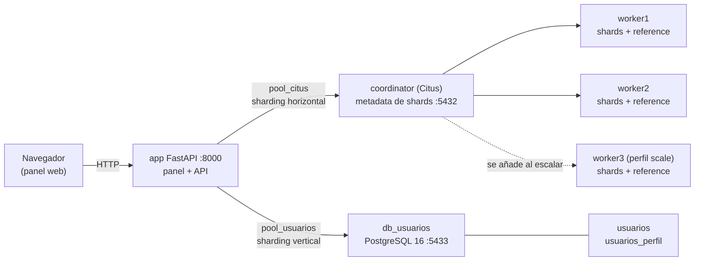
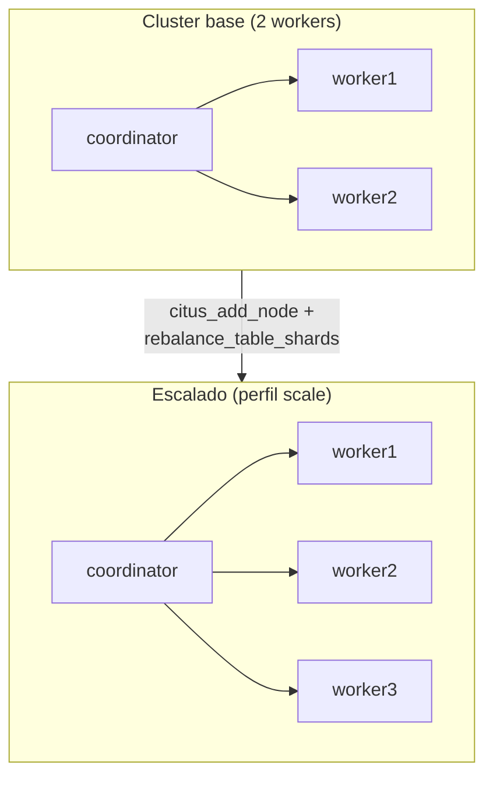
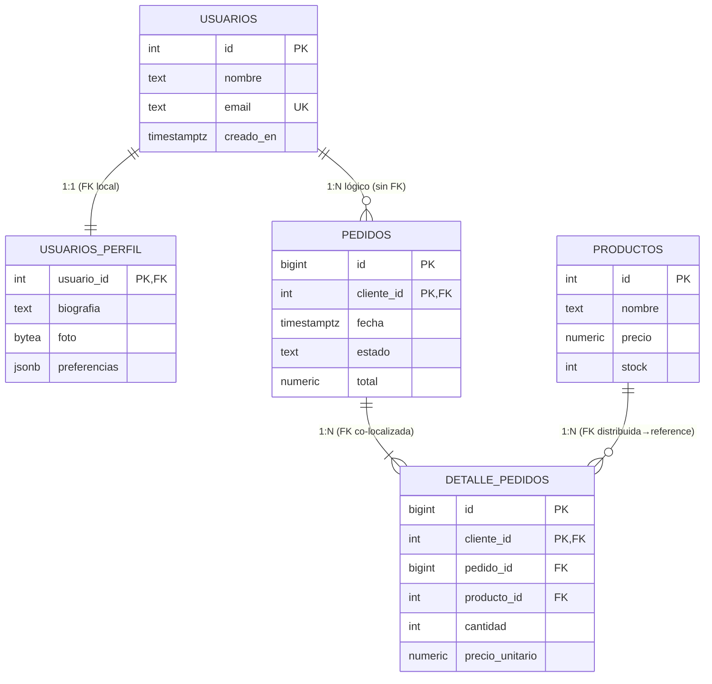

# Arquitectura — ShardShop

Este documento explica **cómo está diseñado** ShardShop: la topología, el modelo
de datos, y las decisiones (y sus contrapartidas) que hacen que el sharding
horizontal y vertical sean visibles y defendibles.

## 1. Diagrama de arquitectura

- El **coordinator** guarda la metadata (`pg_dist_node`, `citus_shards`) y enruta
  las consultas; **no almacena shards**.
- Cada **worker** guarda sus shards de `pedidos`/`detalle_pedidos` y una **copia
  completa** de la reference table `productos`.
- `db_usuarios` es un **dominio aparte** (sin Citus): el sharding vertical.

### Escalado y tolerancia a fallos

Sin replicación de shards, la caída de un worker inutiliza **solo sus shards**.
El detalle está en [`escalabilidad.md`](escalabilidad.md).

## 2. Modelo de datos (entidad-relación)

**Sin FK entre bases.** `pedidos` (cluster Citus) y `usuarios` (`db_usuarios`)
viven en servidores distintos, por lo que **no puede existir una FK** entre
`pedidos.cliente_id` y `usuarios.id`. La app valida la existencia del usuario
antes de crear el pedido. Es una **desventaja real** del sharding vertical: se
pierde la integridad referencial entre dominios.

Las FK que **sí** existen son locales a un dominio: `detalle_pedidos → pedidos`
(co-localizadas) y `detalle_pedidos → productos` (hacia una reference table),
más `usuarios_perfil → usuarios` dentro de `db_usuarios`.

### Notas de esquema

- La clave de distribución **forma parte de la PRIMARY KEY**: `pedidos` y
  `detalle_pedidos` usan `PRIMARY KEY (cliente_id, id)`. Citus lo exige para toda
  tabla distribuida.
- `pedidos` y `detalle_pedidos` comparten `colocationid` (mismo grupo de
  co-locación) gracias a `colocate_with => 'pedidos'`.

## 3. Justificación del motor

**PostgreSQL + Citus 12.1** (`citusdata/citus:12.1`), en lugar de un NoSQL o un
sharding casero:

- **PostgreSQL** aporta garantías ACID, SQL estándar, `jsonb`, `bytea`, tipos
  numéricos exactos (`numeric`) e índices maduros; el proyecto no renuncia a
  nada de eso al distribuir.
- **Citus** convierte PostgreSQL en una base distribuida de forma **transparente
  a nivel de SQL**: `create_distributed_table`, *reference tables*,
  co-locación, poda de shards y `rebalance_table_shards`. El sharding queda
  **explícito y explicable** (se ve en `EXPLAIN` con `Task Count`).
- Permite ilustrar en un solo motor los tres patrones: **distribución
  horizontal**, **reference tables** y **sharding vertical** (este último por
  diseño, con un PostgreSQL aparte).
- Todo corre en **local con Docker Compose**, sin servicios gestionados.

## 4. Justificación de la clave de distribución (`cliente_id`)

Elegir la clave de distribución es la decisión más importante del sharding
horizontal. `cliente_id` se eligió porque:

1. **Alta cardinalidad** (miles de clientes) ⇒ el hash reparte las filas de forma
   uniforme entre shards, evitando concentraciones.
2. **Alineada con el patrón de acceso**: casi todas las consultas de negocio
   filtran por cliente ("pedidos de un cliente"), lo que permite **podar shards**
   (`Task Count: 1`).
3. **Permite co-localizar** `pedidos` y `detalle_pedidos`: con la misma clave,
   un pedido y sus líneas caen en el **mismo shard**, así el JOIN es local y la
   inserción de una compra es una **transacción de un solo shard (sin 2PC)**.
4. **Encaja con la PK**: la PK compuesta `(cliente_id, id)` mantiene unicidad por
   shard sin necesidad de un id global distribuido.

Alternativas descartadas: distribuir por `id` de pedido repartiría bien pero
**rompería la localidad** (pedido y detalle podrían caer en shards distintos) y
no ayudaría a las consultas por cliente; distribuir por `fecha` crearía **hot
shards** (todo lo reciente en un shard).

## 5. Justificación del sharding vertical

El sharding vertical **no lo hace ningún motor automáticamente**: se logra por
diseño. Aquí se aplican dos técnicas:

- **Por dominio (servidor distinto):** los usuarios viven en `db_usuarios`, un
  PostgreSQL aparte del cluster transaccional. Ventajas: el dominio *identidad*
  escala, se respalda y se despliega de forma independiente; se reduce el acoplo
  entre dominios. Coste: **no hay FK entre bases** (hay que validar en la app) y
  una consulta que necesite ambos dominios requiere dos conexiones.
- **Por columnas (tabla aparte):** dentro de `db_usuarios`, las columnas calientes
  (`usuarios`: id, nombre, email, creado_en) se separan de las pesadas
  (`usuarios_perfil`: biografía ~1 KB, foto 30–60 KB, `jsonb`). Como las lecturas
  frecuentes no tocan el perfil, no pagan el I/O de las filas grandes; la
  medición `/demo/vertical` lo evidencia (factor > 1; en las pruebas, ~5.9×).

## 6. Ventajas y desventajas

| Aspecto | Ventaja | Desventaja / coste | Mitigación en ShardShop |
|---|---|---|---|
| **JOIN entre shards** | Cada shard procesa su parte en paralelo | Un JOIN cuya clave no es la de distribución obliga a *reshuffle* (mover datos por red) | Co-localizar `pedidos`/`detalle_pedidos` por `cliente_id`; `productos` como reference table |
| **Transacciones distribuidas** | Permiten escribir en varios shards a la vez | Requieren 2PC (más lento y frágil, locks distribuidos) | Todas las escrituras de una compra caen en **un shard** → transacción local, sin 2PC |
| **Sin FK entre bases** | Cada dominio evoluciona y escala aparte | Se pierde la integridad referencial entre dominios | La app valida el cliente en `db_usuarios` antes de crear el pedido (404) |
| **Elección de clave** | Una buena clave da uniformidad y poda de shards | Una mala clave crea *hot shards* o consultas multi-shard | `cliente_id`: alta cardinalidad + filtrado frecuente + co-localización |
| **Hot shards** | — | Una clave sesgada concentra carga en pocos shards | `cliente_id` bien distribuido; `rebalance_table_shards` iguala el nº de shards por nodo |
| **Reference tables** | JOINs locales sin mover datos; lecturas desde cualquier nodo | Cada escritura se propaga a *todos* los nodos | `productos` es pequeño y de baja escritura (ideal) |
| **Escalado** | Añadir un worker aumenta capacidad | Rebalancear mueve shards (bloquea escrituras con `block_writes`) | `scripts/demo_escalabilidad.sh` lo demuestra |
| **Tolerancia a fallos** | Los shards sanos siguen sirviendo | Sin replicación, la caída de un worker inutiliza sus shards | Documentado; se probaría con replicación/Patroni |
| **Complejidad operativa** | Mayor capacidad y aislamiento | Más nodos, más metadata, más superficie de fallo | Todo local con Docker Compose; metadata visible en `/admin/*` |
| **Sharding vertical** | Aísla dominios y columnas pesadas | Es manual (por diseño); puede requerir *joins* de aplicación | Dominio de usuarios separado + `usuarios_perfil`; `/demo/vertical` lo cuantifica |

## 7. Cuándo usar cada tipo de sharding

| Estrategia | Cuándo usarla | Señales típicas | Ejemplo aquí |
|---|---|---|---|
| **Horizontal (por filas)** | Una tabla crece mucho en filas y las consultas filtran por un atributo de alta cardinalidad | Tablas de eventos/pedidos que no caben en un nodo; necesidad de escalar escritura | `pedidos` y `detalle_pedidos` por `cliente_id` |
| **Vertical por dominio** | Distintos subdominios tienen **ciclos de vida, escalado o compliance** distintos | Un dominio se lee/escala mucho más que otro; conviene aislar fallos y despliegues | `db_usuarios` separado del cluster transaccional |
| **Vertical por columnas** | Una tabla mezcla columnas **ligeras y de acceso frecuente** con columnas **grandes y de acceso esporádico** | `bytea`/`text`/`jsonb` enormes que solo se consultan en detalle | `usuarios` (caliente) vs `usuarios_perfil` (pesado) |
| **Reference table** | Tabla **pequeña, poco cambiante y leída por todas las consultas** | Catálogos, tablas de configuración, `lookups` | `productos` replicada en cada worker |

**Regla práctica:** primero normaliza y separa dominios (vertical); cuando una
tabla sea realmente grande y las consultas lo permitan, distribúyela por una
clave que dé **uniformidad + localidad** (horizontal). Para catálogos pequeños,
usa **reference tables**. Y recuerda: el sharding vertical casi nunca es
automático — se consigue **por diseño**.
